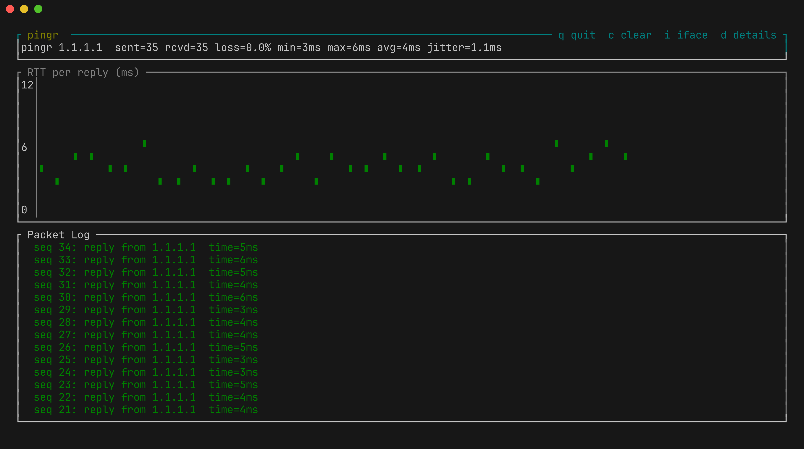
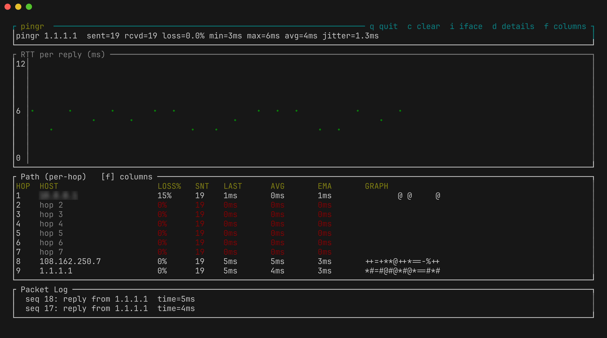
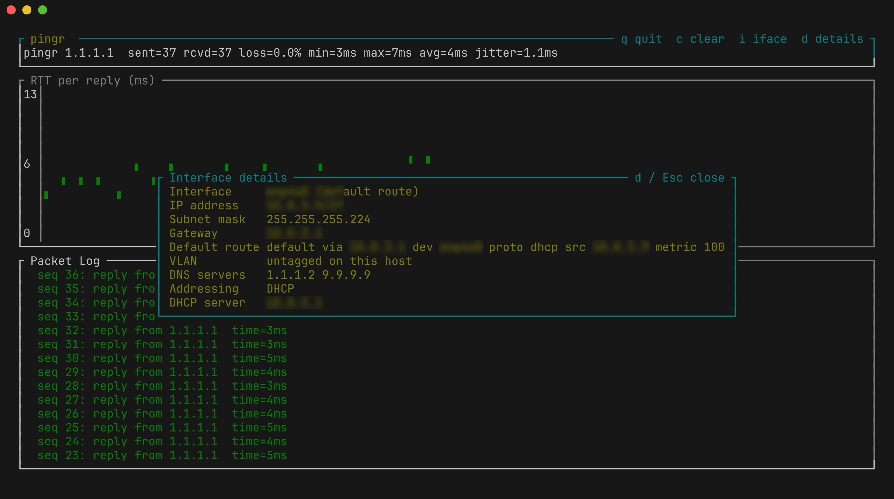

# pingr

`ping` with a live terminal UI, plus an MTR-style path trace.

- **Ping mode** (default): sent/received/loss, min/avg/max/jitter, a live RTT
  scatter chart and a scrolling packet log.
- **Trace mode** (`-t`/`--tr`): everything above plus a per-hop table (loss, last,
  avg, best, worst, stdev, EMA and a coloured latency bar per hop). Probing stops
  at the destination, so you do not get 30 rows of nothing.

Single binary, IPv4 only, Linux only. No root needed on most distros (see below).

This is a fun side project, not a production tool.







## Install

Static binaries for x86_64 and aarch64 Linux (also runs in WSL2) are on the
[Releases](https://github.com/BuildTestRunLabs/pingr/releases) page.

```sh
v=v0.1.1
arch=x86_64   # or aarch64
f=pingr-$v-$arch-unknown-linux-musl
curl -LO https://github.com/BuildTestRunLabs/pingr/releases/download/$v/$f.tar.gz
curl -LO https://github.com/BuildTestRunLabs/pingr/releases/download/$v/$f.tar.gz.sha256
sha256sum -c $f.tar.gz.sha256
gh attestation verify $f.tar.gz --repo BuildTestRunLabs/pingr   # optional
tar xzf $f.tar.gz
sudo install $f/pingr /usr/local/bin/
```

Or with Cargo: `cargo install --git https://github.com/BuildTestRunLabs/pingr`

## Build

Needs a stable Rust toolchain and a C linker (`gcc`).

```sh
cargo build --release
# binary: target/release/pingr
```

## Unprivileged ICMP

pingr opens an ICMP datagram ("ping") socket, which Linux only allows for groups
inside `net.ipv4.ping_group_range`. The kernel default is `1 0` (nobody), but
systemd 243+ sets `0 2147483647`, so most current distros (Ubuntu 20.04+, Fedora,
Arch, Debian 11+) need no setup. This is not specific to trace mode; plain ping
needs it too, as does the system `ping`.

Check yours:

```sh
sysctl net.ipv4.ping_group_range
```

If pingr exits with "no ICMP socket privilege" (it prints your group id and the
current range), pick one:

```sh
# 1. allow everyone (persistent)
sudo sysctl -w net.ipv4.ping_group_range="0 2147483647"
echo 'net.ipv4.ping_group_range=0 2147483647' | sudo tee /etc/sysctl.d/99-ping.conf

# 2. or give just this binary raw-socket capability (redo after each rebuild)
sudo setcap cap_net_raw+ep target/release/pingr

# 3. or run it as root
sudo ./target/release/pingr 1.1.1.1
```

With capability or root, pingr falls back to a raw socket and says so on stderr.

## Usage

```
pingr [OPTIONS] <TARGET>

Options:
  -t, --tr                  trace mode: show the path hop by hop
  -I, --iface <IFACE>       bind the send socket to an interface
  -s, --size <SIZE>         payload bytes (default 56)
      --max-hops <N>        max hops in trace mode (default 30)
  -i, --interval_ms <MS>    time between rounds (default 1000)
      --rounds <N>          exit after N rounds (0 = until quit, default 0)
      --ylim <MS>           fixed chart Y axis in ms (0 = auto, default 0)
  -q, --quiet               no TUI: one line per round
      --report-on-exit      print an MTR-style report to stdout on exit (with --tr)
      --ascii               plain ASCII, no block/braille glyphs (also honours NO_COLOR)
```

```sh
pingr 1.1.1.1                       # ping, run until q
pingr example.com                   # shows the resolved address: example.com (93.184.x.x)
pingr -t 1.1.1.1                    # trace mode
pingr -q --rounds 3 1.1.1.1         # quiet, 3 rounds, then exit
pingr -s 128 -i 500 --ylim 50 host  # bigger payload, 500ms cadence, fixed scale
```

Keys (shown in the top border): `q`/`Esc` quit, `p` pause/resume probing, `c` clear chart, `i` next interface
(cycles the default route then each interface that is up; resets stats), `d` interface
details, `f` toggle extra columns (trace mode).

The `d` modal shows the interface in use (or the one the kernel routes the target
through), its IPv4 address and subnet mask, gateway, default route, VLAN tag, DNS
servers, and whether it is DHCP or static plus the DHCP server. It reads `ip`,
`resolvectl` (falls back to `/etc/resolv.conf`) and systemd-networkd or dhclient
lease files, so the DHCP server shows "unknown" under NetworkManager. The VLAN tag
only shows when the host tags traffic itself (e.g. `eth0.10`); VLANs assigned on a
switch access port are invisible to the host.

### Layout

1. Stats bar: target, sent/rcvd/loss, min/avg/max/jitter, key hints.
2. RTT chart: one point per reply.
3. Hop table (trace mode only): per-hop stats, bar coloured green/yellow/red by latency.
4. Packet log: fills the remaining space, timeouts in red.

## How tracing works

Each round sends one echo request to the target plus, in trace mode, one probe per
TTL. Routers answer expiring probes with ICMP "time exceeded", and the probe's
sequence number says which hop replied. The destination answering a hop probe marks
the end of the path.

Unprivileged ping sockets do not deliver ICMP errors through `recv`; they queue them
on the socket's error queue. pingr sets `IP_RECVERR` and reads that queue with
`recvmsg(MSG_ERRQUEUE)` to get the router addresses. Raw sockets see the errors
directly.

Some routers never answer expiring probes, so hops can show blank. That is normal
and matches what `mtr` and `traceroute` show.

## Development

```sh
cargo test      # unit tests, including a TestBackend render check of the TUI
cargo clippy
```

## Credits and history

- First version written with the [Pi](https://github.com/badlogic/pi-mono) coding
  agent harness and Qwen 3.8.
- Later bug fixes, tests and the unprivileged trace path were done with Claude Code.
- Ideas borrowed from [mtr](https://github.com/traviscross/mtr) (the per-hop table
  and the ping/trace model) and from [mtr-rs](https://github.com/seitzbg/mtr-rs)
  (its documentation of the `IP_RECVERR` fallback for unprivileged ICMP). No code was
  copied from either; both are GPL-licensed and pingr is MIT.
- Built with [ratatui](https://ratatui.rs), [crossterm](https://github.com/crossterm-rs/crossterm)
  and [clap](https://github.com/clap-rs/clap).

## Reading the results

New to ping and path tracing? Read [docs/reading-results.md](docs/reading-results.md).
It explains why middle hops often show 100% loss (usually routers declining to
answer, not a fault), what a real problem looks like, typical Australian
latencies, thresholds for calls, gaming and streaming, and how wired, Wi-Fi,
mobile and satellite connections differ.

The short version: judge loss at the destination. Loss only matters when it
starts at a hop and carries through to every hop after it.

## License

MIT, see [LICENSE](LICENSE).
